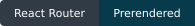

<div align="center">

# Nelu-Cristian Țone

### Senior Full-Stack Engineer with focus on Java

Clean architecture · Thoughtful code reviews · Human-centered leadership

A personal portfolio connecting my engineering experience, selected projects, and the person behind the code.

**[Explore the portfolio ↗](https://cristiantone.taila68086.ts.net/cristiantone/)** · **[View my résumé](public/documents/cristian-tone-dev-resume.pdf)** · **[Connect on LinkedIn](https://www.linkedin.com/in/ctone/)**

[](package.json)
[](tsconfig.json)
[](react-router.config.ts)
[](vite.config.ts)
[](Dockerfile)

**10 prerendered pages** &nbsp; / &nbsp; **5 selected projects** &nbsp; / &nbsp; **9 certificates**

</div>

---

## ◈ A portfolio with purpose

I build high-quality software through clean architecture, rigorous code reviews, and clean, maintainable code. This repository contains the React and TypeScript application that presents my professional journey as a **Senior Java Backend Engineer**.

The portfolio brings together technical experience, leadership, project case studies, and original certificates in a responsive interface. Its content is in English, with a downloadable résumé and direct ways to get in touch.

| Explore                                                                                     | What you will find                                                     |
| :------------------------------------------------------------------------------------------ | :--------------------------------------------------------------------- |
| [Career overview](https://cristiantone.taila68086.ts.net/cristiantone/)           | Experience, technical proficiency, competencies, and industry exposure |
| [Selected projects](https://cristiantone.taila68086.ts.net/cristiantone/projects) | Metal Investment, JobsHunter, Simple Contacts, SnowSWT, and VeriDate   |
| [Certificates](https://cristiantone.taila68086.ts.net/cristiantone/certificates)  | Nine original certificates with an image viewer                        |
| [About me](https://cristiantone.taila68086.ts.net/cristiantone/about)             | The personal side of my professional journey                           |
| [Work with me](https://cristiantone.taila68086.ts.net/cristiantone/hire-me)       | Professional profile, contact options, and résumé                      |

> **Demo access:** the portfolio is published over HTTPS through Tailscale Funnel and is accessible without a Tailscale account.

## ◇ Engineering behind the experience

| Design choice               | Practical outcome                                                                                                               |
| :-------------------------- | :------------------------------------------------------------------------------------------------------------------------------ |
| **Prerendered HTML**        | Each route is built with its content and metadata already present in HTML.                                                      |
| **Typed content models**    | Pages and search share the same maintained TypeScript data.                                                                     |
| **Local assets and fonts**  | Images, résumé, certificates, and Inter font files are served from the site itself.                                             |
| **Accessible interactions** | Semantic content, native dialogs, keyboard gallery controls, and textual chart alternatives support different ways of browsing. |
| **Responsive presentation** | Layouts and interactions are covered at mobile, tablet, and desktop viewports.                                                  |
| **Static delivery**         | The production container serves built files through Nginx, with hashed asset caching and real HTTP 404 responses.               |

**Stack:** React 19 · TypeScript · React Router Framework Mode · Vite · Tailwind CSS 4 · Chart.js · Docker · Nginx

The Technical Proficiency chart uses HTML/CSS bars with values included at build time. The other charts load Chart.js in the browser and retain textual alternatives in HTML. Galleries preserve their original order and use manual navigation; image viewers use native dialogs with focus handling and Escape support.

---

## ▸ Run locally

**Prerequisites:** Node.js 24 or later and npm. Docker is optional for local development and preview. Direct dependency versions are pinned in `package.json`; `package-lock.json` records the resolved dependency tree.

From the repository root:

```powershell
npm ci
npm run dev
```

Open **[localhost:5173/cristiantone/](http://127.0.0.1:5173/cristiantone/)**.

To preview the built static site:

```powershell
npm run build
npm run preview
```

Open **[localhost:8082/cristiantone/](http://127.0.0.1:8082/cristiantone/)**. If port `8082` is occupied, set `$env:PORT = '8083'` before starting the preview.

## ✓ Quality and verification

```powershell
npm run check
```

This runs **TypeScript checks → ESLint → unit and interaction tests → production build**. The build also validates all ten prerendered pages and their referenced local assets.

| Command             | Purpose                                           |
| :------------------ | :------------------------------------------------ |
| `npm run dev`       | Start the development server                      |
| `npm run build`     | Prerender, organize, and validate the static site |
| `npm run preview`   | Serve the production build locally                |
| `npm run typecheck` | Generate route types and check TypeScript         |
| `npm run lint`      | Check source, tests, scripts, and configuration   |
| `npm test`          | Run Vitest and Testing Library tests              |
| `npm run test:e2e`  | Run Playwright against a running instance         |
| `npm run check`     | Run the combined local quality checks             |

<details>
<summary><strong>Browser tests · coverage and setup</strong></summary>

Build and start the local preview in one terminal. In another terminal, run:

```powershell
npx playwright install chromium
npm run test:e2e
```

Playwright targets `http://127.0.0.1:8082` by default, using **360, 768, and 1440 px** viewports. It checks direct navigation and refresh across ten routes, browser errors, local resources, horizontal overflow, mobile navigation, search, galleries, certificates, résumé access, redirects, and missing resources.

The axe audit checks critical and serious accessibility issues. Automated checks support accessibility review; they do not certify complete accessibility.

To target another running instance:

```powershell
$env:E2E_BASE_URL = 'http://127.0.0.1:8083'
npm run test:e2e
```

Generated screenshots and audit outputs live in `artifacts/`; the HTML test report is in `playwright-report/`. Both directories are excluded from Git.

The [migration and verification report](docs/migration-verification.md) records the checks performed during implementation on **10 October 2026**. It is a dated record, rather than a live CI status.

The [Tailscale migration report](docs/tailscale-migration.md) records the deployment and public checks performed on **15 October 2026**.

</details>

## ◇ Find your way around the code

```text
cristiantone-presentation/
├── src/
│   ├── app/             Application root and route definitions
│   ├── pages/           Portfolio pages and project details
│   ├── components/      Layout, charts, galleries, and content rendering
│   ├── content/         Typed content, metadata, search, and skills
│   └── styles/          Responsive styles and compiled Tailwind
├── public/
│   ├── images/          Photographs, logos, galleries, and certificates
│   └── documents/       Original résumé PDF
├── tests/               Unit, interaction, and browser tests
├── scripts/             Build finalization, preview, and Tailscale publishing
└── docs/                Implementation and verification notes
```

| To update…                                                | Edit…                                                                                                                     |
| :-------------------------------------------------------- | :------------------------------------------------------------------------------------------------------------------------ |
| Text, experience, projects, certificates, and their order | [`src/content/migrated.ts`](src/content/migrated.ts)                                                                      |
| Technical proficiency and chart values                    | [`src/content/skills.ts`](src/content/skills.ts)                                                                          |
| Profile, contact links, and URL helpers                   | [`src/content/site.ts`](src/content/site.ts)                                                                              |
| Header portrait                                           | [`public/images/cristian-tone-portrait.png`](public/images/cristian-tone-portrait.png), referenced by `branding.portrait` |
| Downloadable résumé                                       | [`public/documents/cristian-tone-dev-resume.pdf`](public/documents/cristian-tone-dev-resume.pdf)                          |

The public origin and path prefix are maintained in [`src/content/deployment.json`](src/content/deployment.json), shared by page metadata, sitemap/robots generation, and the publishing script.

Rebuild after changing content or assets. Experience values are maintained editorially and are not recalculated automatically.

Use `assetUrl()` for images and documents, and React Router for internal navigation. The application is hosted under **`/cristiantone/`**. Keep site assets local; auxiliary links to GitHub, LinkedIn, Figma, forms, and Google Docs can remain external. Search normalizes case and diacritics and uses the same typed content as the pages.

---

## ▸ Deployment and operations

The build uses `ssr: false` and `prerender: true`, then places the published site in `build/client/cristiantone/`. The final container contains static files and Nginx. Node.js is used during the build.

<details>
<summary><strong>Docker · start and inspect the container</strong></summary>

The Compose configuration uses its own Docker network and binds the portfolio to loopback on port **8082**. Tailscale runs on the Windows host; no external Docker network is required.

```powershell
docker compose up -d --build
docker compose ps
docker compose logs --tail 30 web
```

The portfolio is available at `http://127.0.0.1:8082/cristiantone/`. To use another host port:

```powershell
$env:WEB_PORT = '8083'
docker compose up -d
```

The Dockerfile pins Node 24 and Nginx Unprivileged images by digest. The container runs as UID `101`, with a read-only filesystem, temporary `/tmp`, dropped Linux capabilities, `no-new-privileges`, a healthcheck, and `unless-stopped` restart policy.

Nginx serves generated routes through `try_files $uri $uri/index.html =404`. `/home` and `/portfolio` redirect with HTTP `308`, preserving query strings. Hashed assets use one-year immutable caching; HTML uses `no-cache` with revalidation. `/health` returns HTTP `200`.

</details>

<details>
<summary><strong>Tailscale Funnel · publish and verify</strong></summary>

Public URL: **[cristiantone.taila68086.ts.net/cristiantone/](https://cristiantone.taila68086.ts.net/cristiantone/)**.

Install Tailscale on Windows, sign in, and ensure Funnel is enabled for this node. The installer uses `tailscale` from PATH or `C:\Program Files\Tailscale\tailscale.exe`. Run PowerShell 7:

```powershell
npm run check
docker compose up -d --build --wait
./scripts/install-tailscale.ps1
$env:E2E_BASE_URL = 'https://cristiantone.taila68086.ts.net'
npm run test:e2e
```

The script checks the connected node, configured hostname, local health, and built metadata, snapshots the existing Tailscale configuration under `artifacts/`, and publishes only `/cristiantone`. It verifies public access and preserves existing handlers, including `/medicina`. If verification fails after adding a new handler, it removes only that handler.

The configured route is:

```text
HTTPS /cristiantone → http://127.0.0.1:8082/cristiantone
```

The target includes the prefix because Funnel removes the mount path before forwarding. For another local port, set `WEB_PORT` when starting Compose and pass the same value with `./scripts/install-tailscale.ps1 -LocalPort 8083`.

Funnel runs with `--bg`, so its configuration persists across Tailscale restarts and device reboots. Docker Desktop and Tailscale must be running. Check routing with:

```powershell
& 'C:\Program Files\Tailscale\tailscale.exe' funnel status
```

See the [official Funnel CLI documentation](https://tailscale.com/docs/reference/tailscale-cli/funnel) for prerequisites, HTTPS, and persistence. The portfolio no longer depends on the JobsHunter reverse proxy or its tunnel. The old portfolio proxy location redirects to the new public address; other JobsHunter services retain their existing configuration.

</details>

<details>
<summary><strong>Rollback · restore the previous configuration or image</strong></summary>

To unpublish only the portfolio while preserving other Funnel handlers:

```powershell
& 'C:\Program Files\Tailscale\tailscale.exe' funnel --https=443 --set-path=/cristiantone off
```

Run `./scripts/install-tailscale.ps1` again to republish. Avoid `funnel reset`, which clears shared routing. Configuration snapshots are saved in `artifacts/tailscale-before-*.json` for inspection.

Before rebuilding the image, preserve the currently deployed version:

```powershell
docker image tag cristiantone-presentation:local cristiantone-presentation:rollback
```

To restore that saved version:

```powershell
docker image tag cristiantone-presentation:rollback cristiantone-presentation:local
docker compose up -d --no-build --force-recreate
```

Portfolio updates require only its own container. Keep the other services running.

</details>

---

<div align="center">

### Let's build something worth maintaining.

**[LinkedIn](https://www.linkedin.com/in/ctone/)** &nbsp; · &nbsp; **[GitHub](https://github.com/crisnct)** &nbsp; · &nbsp; **[Email](mailto:nelucristian2005@gmail.com)** &nbsp; · &nbsp; **[Résumé](public/documents/cristian-tone-dev-resume.pdf)**

<sub>Cristian Țone · Senior Java Backend Engineer</sub>

</div>
